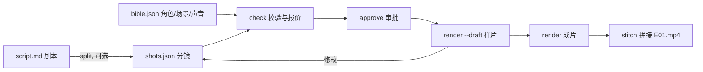

# MiniMax H3 短剧生产管线 · Short-Drama Pipeline

把一集短剧从剧本推进到成片：剧本 → 分镜 → 审批 → MiniMax H3 逐镜头生成 → 拼接。所有状态记在 `production.json` 里，角色和场景用同一套参考图贯穿全集，改了素材的镜头会被标记为过期，没审批的镜头不会花钱。

*English: a stateful pipeline that turns a short-drama episode script into MiniMax H3 shots (approval gate, stale tracking, shared character references, ffmpeg stitch). Python standard library only.*

[为什么需要它](#为什么需要它) · [流水线](#流水线) · [快速开始](#快速开始) · [文件格式](#文件格式) · [成本](#成本) · [限制速查](#minimax-h3-限制速查) · [常见问题](#常见问题)

<sub>核对日期：2026-10-07（模型限制与价格来自下文链接的页面）。</sub>

## 为什么需要它

| 常见问题 | 这个管线的做法 |
|---|---|
| 同一个角色每个镜头长得不一样 | `bible.json` 里每个角色、场景只登记一次参考图；镜头里写【林夏】，自动换成该镜头的 `@Image 1`、`@Image 2` |
| 一上来批量生成，错误被成倍放大 | 先 `check` 看每个镜头的计费秒数和费用，再 `approve` 指定镜头，只有审批过的镜头才会提交 |
| 改了人物图，旧镜头还在用旧素材 | 每个镜头的请求和参考文件都算指纹；素材或提示词一变，`check` 标记为 stale，必须重新审批才能重渲染 |
| 网络超时后重复提交、重复付费 | 已提交或已完成的镜头（指纹相同）不会再提交；`render` 可以随时重跑，只补没做完的 |
| 参考素材每次都要重新上传 | 上传得到的 `media_url` 连同文件哈希缓存 7 天，内容不变就复用 |
| 样片和成片混在一起 | `--draft` 把每个镜头压到 4 秒、768p 先看节奏，文件名带 `-draft` |

## 流水线



状态只写在 `production.json`：每个镜头的审批指纹、`request_id`、状态（`submitted` / `pending` / `done` / `failed` / `expired`）、计费用量和成片路径，以及素材上传缓存。

## 快速开始

```bash
git clone https://github.com/oberonlindquist/minimax-h3-shortdrama-pipeline
cd minimax-h3-shortdrama-pipeline
export H3_API_KEY=你的密钥            # ArgoLink 控制台创建；check 不需要密钥

# 示例集：把 bible.json 里列出的参考图、音频、视频放进 episodes/E01-rain-letter/refs/
python3 drama.py check   episodes/E01-rain-letter            # 校验 8 个镜头并报价
python3 drama.py approve episodes/E01-rain-letter --all       # 或只批几个：approve EP E01-S01 E01-S02
python3 drama.py render  episodes/E01-rain-letter --draft     # 4 秒 768p 样片
python3 drama.py render  episodes/E01-rain-letter             # 成片，下载到 renders/
python3 drama.py status  episodes/E01-rain-letter
python3 drama.py stitch  episodes/E01-rain-letter             # 需要 ffmpeg，输出 E01-rain-letter.mp4
```

`check` 的输出（示例集，参考素材到位前也能运行）：

| 镜头 | 时长 | 分辨率 | 计费秒数 | 费用 |
|---|---:|---|---:|---:|
| E01-S01 | 6 s | 768p | 6 | $0.234 |
| E01-S02 | 6 s | 768p | 9 | $0.351 |
| E01-S03 | 5 s | 768p | 5 | $0.195 |
| E01-S04 | 8 s | 768p | 8 | $0.312 |
| E01-S05 | 6 s | 768p | 6 | $0.234 |
| E01-S06 | 5 s | 768p | 5 | $0.195 |
| E01-S07 | 5 s | 768p | 5 | $0.195 |
| E01-S08 | 6 s | 768p | 6 | $0.234 |

合计 8 个镜头，成片 47 秒，$1.950。S02 多出的 3 秒是动作参考视频的时长：参考视频按秒计费。

### 用模型拆分镜（可选）

```bash
python3 drama.py split episodes/E02-xxx --model gpt-5.6-luna
```

`split` 把 `script.md` 和 `bible.json` 里的名单发给一个对话模型（`POST /v1/chat/completions`），让它按"景别、主体、一个动作、运镜、环境光线、声音和台词"的格式写出分镜，然后用同样的规则逐个校验。已有 `shots.json` 时写到 `shots.draft.json`，不会覆盖你的手改版本。一集剧本的拆分通常只花不到 1 美分（gpt-5.6-luna：每百万输入 token $0.06，输出 $0.36）。

## 文件格式

```text
episodes/E01-rain-letter/
├── bible.json        角色、场景、道具、声音 → 参考文件
├── script.md         剧本（split 的输入）
├── shots.json        分镜
├── refs/             参考图 / 视频 / 音频（自备）
├── renders/          生成的镜头（自动创建）
└── production.json   状态（自动创建）
```

`bible.json` 的 `cast`：

| 字段 | 说明 |
|---|---|
| `type` | `image`、`video` 或 `audio` |
| `file` | 相对于本集目录的路径，或 `https://` 链接 |
| `seconds` | 视频参考的时长，用于报价（参考视频按秒计费） |
| `note` | 给人看的说明：外形、用途 |

`shots.json` 每个镜头：

| 字段 | 说明 |
|---|---|
| `id` | 镜头号，如 `E01-S03`，也是成片文件名 |
| `duration` | 4–15 秒整数 |
| `cast` | 本镜头用到的名单；顺序决定编号（每类单独从 1 数起） |
| `prompt` | 用【名字】指代名单里的成员，台词放在引号里并写明是谁说的 |
| `resolution`、`aspect_ratio` | 可选，覆盖 `bible.json` 的默认值（`768p` / `2k`；21:9、16:9、4:3、1:1、3:4、9:16） |
| `first_frame`、`last_frame` | 首帧 / 首尾帧镜头的图片；这类镜头不能再用 `cast` |

例：`"cast": ["林夏", "周屿", "旧书店"]` 时，"【林夏】把信推向【周屿】"发送为 `@Image 1 把信推向@Image 2`，三张图按顺序放进 `reference_images`。

## 成本

按镜头计费：计费秒数 = 成片秒数 + 参考视频总秒数（不足 1 秒舍去）；参考图片和音频不收费；失败或过期的任务不收费。

| 示例集 E01（8 个镜头，47 秒 + 3 秒参考视频） | 768p | 2K |
|---|---:|---:|
| **[ArgoLink](https://argolink.io/gh-minimax-h3-shortdrama-pipeline)**（$0.039 / $0.064 每秒） | **$1.95** | **$3.20** |
| ArgoLink 样片 `--draft`（每镜头 4 秒、768p，共 35 计费秒） | $1.37 | — |
| [MiniMax 按量付费官方价](https://platform.minimax.io/docs/guides/pricing-paygo)（$0.08 / $0.13 每秒，参考视频同样按秒计费） | $4.00 | $6.50 |

<sub>价格于 2026-10-07 读取。MiniMax 官方对每个请求第 6 张起的参考图另收 $0.04/张，示例集每个镜头最多 3 张，不涉及。预算前请再看一眼链接页面。</sub>

## MiniMax H3 限制速查

| 项目 | 限制 |
|---|---|
| 模型 ID | `minimax-h3`，接口 `POST /v1/videos/generations` → `GET /v1/videos/{request_id}` → `GET /v1/videos/{request_id}/content` |
| 时长 | 4–15 秒整数 |
| 分辨率 | `768p` 或 `2k`（没有 720p、1080p） |
| 画幅 | 21:9、16:9、4:3、1:1、3:4、9:16；首帧/首尾帧镜头跟随首帧（`adaptive`） |
| 参考素材 | 每个镜头最多 9 图、3 视频、3 音频，共 12 个；视频和音频每段 2–15 秒、每类合计 15 秒 |
| 音频参考 | 必须同时有图片或视频参考 |
| 声音 | 每条成片都带生成的立体声音轨，不能关闭 |
| 上传 | 图片 JPEG/PNG ≤ 20 MiB，视频 MP4/MOV ≤ 100 MiB，音频 WAV/MP3 ≤ 15 MB；`media_url` 7 天有效 |
| 不支持 | `seed`、`watermark: true`、一次多条 |

管线在提交前就按这些规则校验，违规的镜头不会产生任何请求。

## 常见问题

**为什么要单独审批？**
生成按秒收费。`approve` 记录的是镜头当时的完整指纹（提示词、设置和参考文件内容），之后任何改动都会让审批失效，避免改了素材却直接把整集重新付费生成一遍。

**角色在不同镜头里还是会有差别吗？**
会有细微差别。同一张参考图贯穿所有镜头是最直接的办法；参考图用正面、光线均匀、纯色背景的半身照，提示词里不要再重复描写长相。

**能做无声版本吗？**
MiniMax H3 每条成片都带音轨。需要无声版时在拼接后去掉：`ffmpeg -i in.mp4 -an -c:v copy out.mp4`。

**拼接失败怎么办？**
`stitch` 默认无损拼接（`-c copy`），要求所有镜头分辨率和画幅一致。混用了 768p 和 2K、或不同画幅时，加 `--reencode` 重新编码。

**某个镜头失败了？**
失败不计费。`production.json` 里记录了错误码和原因；改好输入后重新 `approve` 这个镜头，再 `render`，只会重做它。

## 测试

```bash
pip install pytest && pytest tests/
```

测试用假的 HTTP 层，不需要密钥，不会产生费用。

## 许可证

MIT
